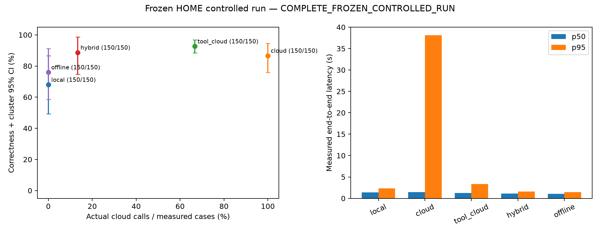

# Финальный HOME-эксперимент: фактические результаты 2 октября 2026 года

**Заранее заданная гипотеза о гибридной политике не подтверждена.** Гибрид дал 133 правильных решения из 150, а «инструменты + облако» — 139 из 150. Парная разница составляет −4,00 процентного пункта; 95 % кластерный bootstrap-интервал — от −17,65 до +5,83 процентного пункта. Нижняя граница не достигает замороженного порога −5 процентных пунктов. Неухудшение качества, то есть noninferiority, **не продемонстрировано**. Этот результат не доказывает статистически значимый вред или превосходство одной политики: интервал содержит ноль.

Остальные три критерия выполнены на этой контрольной выборке: гибрид использовал 20 облачных вызовов вместо 100, наблюдавшийся прирост узко определённых `critical_error` равен нулю, а p95 задержки гибрида составил 1,561 секунды. Экономия вызовов и задержки не заменяет невыполненный критерий качества.

## Что фактически выполнено

Оценены 150 новых заданий: 75 на английском и 75 на русском языке, 25 замороженных групп `sample.group`, шесть категорий. QA опирается на пять документов; остальные задания включают контролируемые семейства. В каждой политике есть все 150 измеренных решений. Всего сохранены **750 уникальных пар «ID задания — политика»**, без `NOT_RUN` и без пропущенных решений. Исходный scorer пересчитан для всех строк и совпал с записанными оценками. Провайдеры вызывались независимо для каждой политики; ответы не переиспользовались.

Протокол зафиксирован до исполнения: `2026-10-02T04:34:45.748327Z`. На модели, prompt, данные, gold, scoring и критерии после начала эксперимента изменения не вносились. Сохранённый машинный статус анализа — `COMPLETE_FROZEN_CONTROLLED_RUN`; полнота относится к набору решений. Исполнение имеет явно раскрытое процедурное отклонение: два сегмента после ошибки файловой системы.

Первый сегмент `20261002_043909Z_5d0044d9_final` остановился после шести заданий и 30 решений из-за `WinError 5` при замене манифеста. До остановки завершены 10 локальных и 12 облачных HTTP-попыток; незавершённых попыток не было. Исходные файлы, включая оставшийся `manifest.tmp`, сохранены без изменений. Его предварительный счётчик 11 локальных вызовов не учитывается как выполненный вызов.

После отдельного разрешения на ручное продолжение второй сегмент `20261002_045739Z_06b07e40_final_continuation` выполнил только оставшиеся 144 задания и 720 решений. Он добавил 300 локальных и 258 облачных попыток. Порядок заданий и перемежающийся порядок политик соответствуют исходному полному расписанию. Ни одно из первых 30 решений и ни одна из первых 22 HTTP-попыток не повторялись. В объединении — **310 локальных и 270 облачных попыток**; количество trace, `call_started` и `call_finished` совпадает. Завершение второго сегмента: `2026-10-02T05:22:24.342515+00:00`. Собственный экземпляр модели выгружен; проверка после выполнения не обнаружила загруженных экземпляров.

Новый объединённый вход и анализ созданы отдельно от обоих сегментов. [Манифест объединения](../results/analysis_input_reconciled_20261002_052358Z_804ced2b/manifest.json) содержит SHA исходных файлов, отдельные метаданные сегментов и описание продолжения. Сводка только по 144 заданиям не перенесена в итоговый манифест: его фаза — `HOME_FINAL_RECONCILED`, объём — 150 заданий и 750 решений.

После выполнения проекта прошли **241 тест** за 18,96 секунды. Защищённые старые 90 test-заданий, core/scoring, frozen dataset и protocol проверены без изменений; повторный анализ дал те же статистические значения. Lint не настроен и не объявляется выполненным. Отдельная проверка demo на старом DEV не входит в эти 750 решений: operability health/GDD/missing-data прошла, а QA `about 13` при gold `13` дал formal span FAIL по неизменённому exact scorer, несмотря на совпавшее numeric 13. Этот результат раскрыт отдельно и не подмешан в финальную выборку.

## Настройки и фактическое поведение провайдеров

Локальный вариант — `gemma-4-26b-a4b-it`, `IQ4_NL_XL`, context 4096, parallel 1, запрошенный GPU offload 0,70, temperature 0, top_p 1, seed 42, reasoning `none`, максимум 512 токенов и строгая JSON Schema с пятью полями. В 310 локальных вызовах возвращён usage; reported reasoning tokens — 0, наблюдавшихся reasoning-каналов — 0. Native load metadata подтверждает context 4096, parallel 1 и offload KV cache в GPU; фактическое число выгруженных в GPU слоёв осталось **UNKNOWN**. Запрошенный коэффициент 0,70 не подменяет измерение числа слоёв или частной памяти модели.

Облако — `mercury-2.5`, reasoning `instant`, максимум 512 токенов и `json_object` с исходным минимальным `parse_output`. **Запрошенная temperature была 0, но провайдер сообщил применение temperature 1.** Во всех 258 возвращённых raw responses присутствует предупреждение о том, что 0 находится вне диапазона [0,5; 1] и заменяется на 1. Raw model ID в этих 258 ответах — `mercury-2.5`. Для 12 попыток с `ReadTimeout` raw response отсутствует: конкретное серверное исполнение и usage неизвестны. Настройки не менялись, повторных облачных вызовов для исправления или статистики не было. [Наблюдения по провайдеру](../results/analysis_input_reconciled_20261002_052358Z_804ced2b/analysis_20261002_052438Z_2c0beea8/provider_observations.json) содержат предупреждение и его покрытие по политикам.

Сравниваются зафиксированные системы целиком: локальная строгая schema и облачный JSON object различаются, а облачная temperature фактически сообщена как 1. Это не чистая причинная оценка знаний модели или эффекта её размера. В основном contrast обе политики имеют одинаковый hard gate и одинаковые облачные настройки; сравнение дополнительного локального этапа остаётся определённым для этого полного протокола. Один результат на пару «задание — политика» не измеряет изменчивость между повторными стохастическими облачными прогонами.

## Общие результаты и замороженные критерии

Качество ниже — доля решений, признанных правильными неизменённым scorer. Ошибки провайдера входят в знаменатель; неизвестные значения не заменяются правильными ответами или нулями. Интервалы получены 5000 повторениями bootstrap целых групп, seed 20261001; estimand — среднее по строкам, а не равновзвешенное среднее групп.

| Политика | Правильно / измерено | Качество | 95 % cluster CI | `critical_error` | Ошибки вызовов | Облачные / локальные / tool calls |
|---|---:|---:|---:|---:|---:|---:|
| Только локальная | 102 / 150 | 68,00 % | 49,37–86,51 % | 32 | 0 | 0 / 150 / 0 |
| Только облачная | 130 / 150 | 86,67 % | 75,76–94,52 % | 0 | 16 | 150 / 0 / 0 |
| Инструменты + облако | 139 / 150 | 92,67 % | 88,46–96,72 % | 0 | 5 | 100 / 0 / 30 |
| Гибрид | 133 / 150 | 88,67 % | 74,76–98,59 % | 0 | 0 | 20 / 80 / 30 |
| Offline | 114 / 150 | 76,00 % | 58,62–91,18 % | 0 | 0 | 0 / 80 / 30 |

`critical_error` имеет исходное узкое определение: категория `numeric` или `missing_data`, действие `ANSWER` и неправильный результат. Неправильные решения в `rule_interpretation` и `compound_reasoning`, пустой или непарсируемый output этот счётчик не увеличивают. Его нулевое значение не означает отсутствие остальных ошибок или агрономическую безопасность.

| Основной критерий: гибрид относительно «инструменты + облако» | Замороженный порог | Фактическое значение | Результат |
|---|---:|---:|---|
| Нижняя граница парного 95 % CI качества | ≥ −5,00 п.п. | −17,65 п.п. | **FAIL** |
| Дополнительное сокращение облачных вызовов от всех 150 заданий | ≥ 10,00 п.п. | (100 − 20) / 150 = 53,33 п.п. | PASS |
| Верхняя граница CI прироста `critical_error` | ≤ 0 | 0 | PASS |
| p95 end-to-end гибрида | ≤ 10 секунд | 1,561 секунды | PASS |

Разница качества равна −4,00 п.п. Парный CI сокращения облачных вызовов — 24,24–74,15 п.п.; критерий использует заранее заданный point estimate с общим знаменателем 150. Парный CI разницы `critical_error` вырожден в [0; 0], поскольку наблюдавшихся discordances нет. Он не доказывает отсутствие редкого риска вне выборки. Описательный McNemar: 7 выигрышей гибрида, 13 проигрышей, 20 discordant pairs, p = 0,2632. При зависимых вариантах и нескольких сравнениях это не основание объявлять equivalence, noninferiority или статистически значимое ухудшение. Wilson и остальные contrasts сохранены как описательные результаты в полном JSON.

## Категории, QA и языки

| Категория | Заданий | Только локальная | Только облачная | Инструменты + облако | Гибрид | Offline |
|---|---:|---:|---:|---:|---:|---:|
| Extractive QA | 40 | 36 | 37 | 32 | 36 | 36 |
| Numeric | 30 | 0 | 23 | 30 | 30 | 30 |
| Missing data | 20 | 18 | 18 | 20 | 20 | 20 |
| Tool selection | 20 | 20 | 18 | 20 | 19 | 0 |
| Rule interpretation | 20 | 20 | 18 | 19 | 20 | 20 |
| Compound reasoning | 20 | 8 | 16 | 18 | 8 | 8 |

В 30 локальных numeric outputs числовое поле было валидным и unit совпадал с gold, но все 30 значений находились вне исходной tolerance: 1 % relative / 0,02 absolute. Это наблюдение о данной конфигурации, а не универсальный вывод о численных способностях модели. Детерминированный этап дал 30 из 30 в этом замороженном наборе; независимые проверки формул и границ описаны отдельно в `TOOL_VALIDATION_HOME_PC_RU.md`.

| Политика | Всё качество EN / 75 | Всё качество RU / 75 | QA EM EN / 20 | QA EM RU / 20 | QA F1 EN | QA F1 RU |
|---|---:|---:|---:|---:|---:|---:|
| Только локальная | 49 | 53 | 17 | 19 | 0,9233 | 0,9833 |
| Только облачная | 65 | 65 | 19 | 18 | 0,9750 | 0,9762 |
| Инструменты + облако | 71 | 68 | 17 | 15 | 0,8861 | 0,8995 |
| Гибрид | 65 | 68 | 17 | 19 | 0,9233 | 0,9833 |
| Offline | 55 | 59 | 17 | 19 | 0,9233 | 0,9833 |

Средние QA F1 по всем 40 QA: локальная 0,9533; облачная 0,9756; «инструменты + облако» 0,8928; гибрид и offline 0,9533. EM включает правильность action и исходное нормализованное сравнение span; token F1 остаётся отдельной диагностикой scorer. EN/RU здесь — описательные срезы связанных переводных и контролируемых вариантов. Независимая человеческая проверка перевода и gold остаётся **PENDING**; эти числа не доказывают превосходство модели на одном из языков.

## Маршрутизация, ошибочная опора и offline

Гибрид выполнил 30 deterministic tool решений и 20 hard-gate запросов `ASK_FOR_DATA`; 80 заданий с context были приняты после локального ответа, а 20 задач tool selection без context направлены прямо в облако. Переходов `LOCAL_TO_CLOUD` в этом прогоне не было: substring-verifier принял все 80 локальных context responses, включая неправильные.

В `compound_reasoning` гибрид и offline дали по **8 правильных решений из 20**. В каждом случае 12 неправильных локальных ответов были приняты как имеющие буквальную опору: обе метки присутствуют в supplied context, поэтому substring подтверждает наличие метки, но не правильность вычисленной ветви. Например, у `home_final_20261001_0145` gold — `OK`, output — `ALERT`; у `home_final_20261001_0137` gold — `ALERT`, output — `OK`. Ответы найдены в context и прошли verifier, но exact score — false. Это объясняет наблюдавшийся провал этой категории; `critical_error` в этих случаях false по узкому исходному определению. В `rule_interpretation` гибрид дал 20 из 20, поэтому ошибочные rule branches для него не объявляются наблюдавшимися.

| Политика | ANSWER | ASK_FOR_DATA | ABSTAIN | Нет output | Ошибка среди ANSWER |
|---|---:|---:|---:|---:|---:|
| Только локальная | 132 / 150 | 18 / 150 | 0 | 0 | 36,36 % |
| Только облачная | 115 / 150 | 19 / 150 | 0 | 16 / 150 | 2,61 % |
| Инструменты + облако | 125 / 150 | 20 / 150 | 0 | 5 / 150 | 4,80 % |
| Гибрид | 129 / 150 | 21 / 150 | 0 | 0 | 12,40 % |
| Offline | 110 / 150 | 20 / 150 | 20 / 150 | 0 | 14,55 % |

У offline answer coverage — 73,33 %, ASK coverage — 13,33 %, abstention coverage — 13,33 %. Все 20 offline abstentions относятся к tool selection, где gold требует ANSWER. В выборке нет ни одного gold `ABSTAIN`; **correct abstention rate — UNKNOWN**, а наблюдавшиеся 20 отказов не являются измерением способности правильно распознавать неотвечаемые задачи. Coverage считается от измеренных решений; здесь все 150 решений измерены.

## Задержки и надёжность

Все 750 end-to-end timers измерены при фактическом исполнении. Они включают routing, инструменты и HTTP внутри решения, не являются replay или CLI-реконструкцией. Загрузки модели и перерыв между сегментами исключены из этих запросных задержек и указаны отдельно.

| Политика | Средняя задержка, секунды | p50, секунды | p95, секунды |
|---|---:|---:|---:|
| Только локальная | 1,508 | 1,422 | 2,349 |
| Только облачная | 4,758 | 1,446 | 38,115 |
| Инструменты + облако | 2,682 | 1,277 | 3,340 |
| Гибрид | 0,844 | 1,094 | 1,561 |
| Offline | 0,655 | 1,042 | 1,458 |

Относительно «инструменты + облако» mean гибрида меньше на **1,838 секунды, или 68,55 %**, а p95 — на **1,779 секунды, или 53,27 %**. Парный group-bootstrap CI разницы mean latency: от −3,660 до −0,079 секунды. Это измеренные различия полных политик на данном наборе и данном хосте; они не подменяют результат по качеству.

Из 270 облачных попыток 21 завершилась ошибкой: 12 `ReadTimeout`, 6 `JSONDecodeError`, 2 `ValueError`, 1 `IncompleteCompletion`. В cloud-only — 16 ошибок, в «инструменты + облако» — 5, в гибриде — 0 из 20 облачных попыток. В 310 локальных попытках ошибок транспорта/парсинга не зарегистрировано. Нулевое число ошибок у 20 облачных попыток гибрида не является оценкой гарантированной надёжности сервиса. Ошибочные measured outputs сохранены и входят в качество.

Локальная медиана клиентского TTFT: 0,578 секунды для local-only и около 0,280 секунды для локальных вызовов гибрида/offline; покрытие соответственно 150 / 150, 80 / 80 и 80 / 80. Приближённая клиентская скорость — 46,65; 47,96; 48,00 completion tokens/s. Метод делит reported completion tokens на интервал между первой и последней непустой delta; он не является измерением backend decode TPS. Cloud backend TTFT/TPS — **UNKNOWN**: замороженный облачный вызов не стримится.

## Usage и стоимость

Цены расчёта заморожены на 1 октября 2026 года: $0,04 за миллион input tokens и $0,15 за миллион completion tokens; cached discount не применяется. Это **оценка по токенам, не invoice**. Электричество, амортизация GPU и полная локальная себестоимость не измерены.

| Политика / провайдер | Вызовы | Известные input tokens | Известные completion tokens | Usage coverage | Reported reasoning tokens |
|---|---:|---:|---:|---:|---:|
| Local-only / local | 150 | 76 582 | 5 749 | 150 / 150 | 0 |
| Cloud-only / cloud | 150 | 86 561 | 25 027 | 142 / 150 | 667 |
| Tools + cloud / cloud | 100 | 55 437 | 14 134 | 96 / 100 | 1 442 |
| Hybrid / local | 80 | 39 476 | 2 649 | 80 / 80 | 0 |
| Hybrid / cloud | 20 | 10 781 | 2 401 | 20 / 20 | 241 |
| Offline / local | 80 | 39 476 | 2 649 | 80 / 80 | 0 |

Итого известны 155 534 локальных input и 11 047 completion tokens; для облака — 152 779 input и 41 562 completion tokens при покрытии 258 из 270 вызовов. Облачные 2 350 reported reasoning tokens являются подмножеством completion tokens и **не добавляются к ним повторно**. Missing usage у 12 `ReadTimeout` остаётся неизвестным, а не нулевым.

| Политика | Известная облачная оценка за 150 заданий, USD | Неизвестная стоимость вызовов | Оценка на 1000 заданий при данном составе |
|---|---:|---:|---|
| Только локальная | 0 | 0 | Облачная часть 0; локальная себестоимость UNKNOWN |
| Только облачная | 0,00721649 | 8 | Известная нижняя часть uncached estimate: 0,04810993 USD; полная оценка UNKNOWN |
| Инструменты + облако | 0,00433758 | 4 | Известная нижняя часть uncached estimate: 0,02891720 USD; полная оценка UNKNOWN |
| Гибрид | 0,00079139 | 0 | Полная по возвращённому usage облачная оценка: 0,00527593 USD |
| Offline | 0 | 0 | Облачная часть 0; локальная себестоимость UNKNOWN |

Сумма известной облачной оценки всех пяти политик — **0,01234546 USD плюс неизвестная оценка 12 вызовов**. Резерв budget guard для них — 0,0038016 USD, то есть резерв учёта, не наблюдавшийся счёт. Полный invoice не получен. Нижние части оценки не являются нижними границами фактического invoice: провайдерские скидки и billing неизвестны. У гибрида покрытие usage полное, поэтому его token estimate можно сравнить с известной частью других политик, сохраняя неизвестность их полной стоимости.

## Ресурсы и процедурное продолжение

| Сегмент | Заданий / решений | Локальные / облачные попытки | Загрузка instance, секунды | Sampled peak всего GPU, MiB | Sampled peak всей RAM, GiB | Resource samples |
|---|---:|---:|---:|---:|---:|---:|
| Первый, прерванный | 6 / 30 | 10 / 12 | 14,778 | 13 598 | 24,326 | 202 |
| Ручное продолжение | 144 / 720 | 300 / 258 | 8,767 | 13 758 | 24,754 | 2 660 |

Промежуток между последним resource sample первого сегмента и первым sample продолжения — **998,585 секунды**, около 16 минут 39 секунд. Это измерение границ sampling, а не точная длительность всех организационных действий. Две загрузки и этот перерыв не входят в таблицу request latency. Пик по 2862 samples активных сегментов — 13 758 MiB всего GPU и 24,754 GiB всей системной RAM. В перерыве ресурсы не измерялись. Это не частная allocation модели или отдельной политики; хост не был изолирован от обычных приложений. Продолжение сохранило ноль resource polling errors; error log первого сегмента не сохранился в прерванном манифесте и остаётся **UNKNOWN**.

## Происхождение артефактов и ручной аудит

[Исходный frozen statistics.json](../results/analysis_input_reconciled_20261002_052358Z_804ced2b/analysis_20261002_052438Z_2c0beea8/statistics.json) сохранён без исправлений. В нём отчётный `ask_coverage` ошибочно считает сокращение `ASK`, тогда как исходная схема использует `ASK_FOR_DATA`. [Отдельный statistics_reporting_corrected.json](../results/analysis_input_reconciled_20261002_052358Z_804ced2b/analysis_20261002_052438Z_2c0beea8/statistics_reporting_corrected.json) меняет **только пять полей `summary.<policy>.ask_coverage`**, вычисляя их из `action_counts.ASK_FOR_DATA / measured_n`. Он хранит SHA родительского JSON и точный diff. Качество, gold, scorer, критерии, интервалы, latency и cost не изменены. Эта таблица и workbook используют исправленный reporting JSON; `summary.csv` сохраняет исходное ошибочное поле для аудита и не является источником ASK coverage.

В исходных Windows protocol copies использованы CRLF, а frozen source — LF. Подмена только CRLF на LF даёт **точный исходный frozen SHA**; произвольное семантическое равенство не принимается. В новом объединённом входе записаны нормализованные frozen bytes и оба исходных SHA. Оригинальные копии не редактировались. Это исправление сериализации происхождения, не изменение параметров.

[Manual 30 CSV](../results/analysis_input_reconciled_20261002_052358Z_804ced2b/analysis_20261002_052438Z_2c0beea8/manual30.csv) содержит по пять заданий каждой из шести категорий: ID, source/group, язык, вопрос, context, inputs, gold, eligibility из публичных входов, фактические local/cloud/hybrid outputs и исходные scores. Отобраны первые пять заданий категории в замороженном порядке; это диагностическая таблица, а не дополнительная случайная выборка. Независимый человеческий аудит всех 30 строк, перевода и gold — **PENDING**. Автоматический экспорт и пересчёт scores не объявляются человеческим аудитом.

[Manual 30 с явными маршрутами](../results/analysis_input_reconciled_20261002_052358Z_804ced2b/analysis_20261002_052438Z_2c0beea8/manual30_routes_display.csv) — отдельный nonfrozen reporting display для **тех же 30 ID**. Он добавляет `expected_route_from_inputs`, actual route/status для local/cloud/hybrid, correctness и пояснения. `DETERMINISTIC_TOOL` и `ASK_FOR_DATA` означают hard-gate eligibility из публичных inputs для tool_cloud/hybrid/offline; `MODEL_REQUIRED` означает необходимость модельного ответа, а не предсказание его правильности или точного последующего маршрута. Исходный CSV, gold и scoring не изменены; [provenance display](../results/analysis_input_reconciled_20261002_052358Z_804ced2b/analysis_20261002_052438Z_2c0beea8/manual30_routes_display_provenance.json) хранит parent SHA, raw SHA и список этих 30 ID.

Для повторного анализа сохранённых журналов, без inference:

```powershell
.venv\Scripts\python.exe scripts\analyze_home_final.py results\analysis_input_reconciled_20261002_052358Z_804ced2b
```

Команда создаёт новую эксклюзивную `analysis_*` папку. Статистические эффекты воспроизводятся с фиксированным seed; служебные timestamp и имя новой папки меняются. Отдельная ASK reporting correction применяется к JSON новой папки; существующие JSON не перезаписываются.

| Артефакт | SHA256 |
|---|---|
| Frozen dataset | `3a4d47451fec18794b084d08d5f45c80b1443d3f99afca4656f9b335b578ac03` |
| Frozen protocol | `795c58a8f5be6521382f82d19718d9e5225de945f5797d7012bd6bc15c097e6c` |
| Объединённый raw journal | `70cdc82fe4d9f01a09b10287304c6a7f7f25f61d13c3fbdab91c1cf7c0a6e922` |
| Объединённый manifest | `406ae3e3f3058b1e10ecac772921d5e902e7afc1bfabae129a77b5786d0ee5d8` |
| Frozen analyzer | `9053e78b3cd632fa5e09a6e7ed0a77b48799131d38e5473467f01237cb29d5d2` |
| Frozen statistics.json | `853873e0cf092afa42eaf1983c6c929628ad7718fb93acd3e3231c418307eb9c` |

CSV с нормализованными 750 решениями, category/language routing и reliability, paired effects и четырьмя критериями находится рядом с JSON. Стандартный Matplotlib-график сохранён в PNG и SVG; визуальная проверка выполнена.



График отражает полный набор измеренных решений; его frozen status не означает непрерывное исполнение без отклонений. Основное ограничение остаётся научным: 150 контролируемых заданий, связанные варианты и только пять QA документов не подтверждают перенос на реальные агрономические решения. Bootstrap использует замороженные 25 групп; зависимость на более высоком уровне документов или семейства шаблонов может сохраняться. Результат фиксирует наблюдавшийся компромисс: значительное сокращение облачных вызовов и задержки при **неподтверждённом неухудшении качества**.
