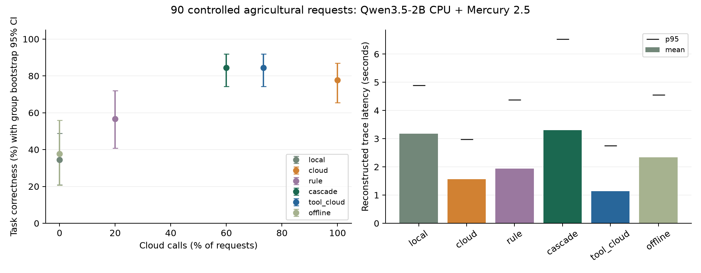

# Результаты выполненного эксперимента

Дата: 30.09.2026. Основной test — **20260930T182756Z_6703e43b**, 90 пар ответов Qwen3.5-2B GGUF Q4_K_M и **mercury-2.5**. Корпус содержит 360 запросов; реальные model calls выполнены на 36 + 36 dev и 90 test. Train 180 не прогонялся, обученного router нет. Протокол зафиксирован в 18:27:25 UTC, test начат в 18:27:56 UTC. Dataset SHA-256: `03ce1fd188fbd46d2a69fed37ac0f773be3008a814b93c6d646ed8c6aa30e3ca`.

**Основной вывод:** каскад сократил обращения к облаку при сохранении измеряемого качества относительно tools+cloud. Локальная ступень добавила экономию вызовов, но увеличила задержку. Это ограниченный результат для данного корпуса и моделей, а не проверка готовых агрономических рекомендаций.

## Итоговая таблица

Quality — правильность завершения задачи, включая ASK_FOR_DATA. Latency — реконструкция выбранных стадий из реально измеренных HTTP вызовов и времени gate; отдельный live performance run каждой политики не выполнялся.

| Метод | Правильно | 95% group bootstrap CI | Cloud calls из 90 | Mean / p50 / p95, секунды | Известная cloud USD за 90 | Critical errors |
|---|---:|---:|---:|---:|---:|---:|
| local | 31/90 (34.4%) | 20.8–48.9% | 0 | 3.179 / 2.985 / 4.888 | 0.00000000 | 14 |
| cloud | 70/90 (77.8%) | 65.5–86.9% | 90 | 1.564 / 1.393 / 2.977 | 0.00435224 + unknown | 3 |
| rule | 51/90 (56.7%) | 40.7–72.0% | 18 | 1.935 / 1.947 / 4.381 | 0.00071200 | 0 |
| cascade | 76/90 (84.4%) | 74.4–91.9% | 54 | 3.298 / 3.949 / 6.533 | 0.00248949 + unknown | 0 |
| tool_cloud | 76/90 (84.4%) | 74.4–91.9% | 66 | 1.136 / 1.189 / 2.748 | 0.00294341 + unknown | 0 |
| offline | 34/90 (37.8%) | 20.6–55.9% | 0 | 2.345 / 2.719 / 4.552 | 0.00000000 | 0 |

12 запросов выполнены численными инструментами, ещё 12 завершены проверкой входов и уточнением. Это 26.7 процентного пункта снятых облачных обращений. Cascade принял 12 локальных QA ответов, из них 10 правильны по strict exact match. **40% запросов обходятся без облака, но сама локальная модель обслуживает 13.3%**, остальные обслуживают инструменты и проверки.

Cascade в среднем медленнее cloud-only в 2.11 раза и tools+cloud в 2.90 раза. Гипотеза об ускорении на этом CPU не поддержана. Rule экономит больше cloud calls, но теряет 21.1 п.п. качества относительно cloud. Выбор метода зависит от допустимого качества, задержки и облачного бюджета.

Главная фигура сравнивает quality, cloud calls и latency для всех методов. Дополнительная `quality_cost_latency.png` исключает из cost scatter методы с неизвестной полной стоимостью: неполный bill не показан как точный. Условные cost ranges приведены ниже; это planning assumptions, не доверительные интервалы.

## Гипотезы и парное сравнение

Cascade − cloud: **+6.67 п.п.**, paired cluster bootstrap 95% CI **+1.11…+14.29 п.п.**, 6 wins / 0 losses. Tools+cloud имеет тот же correctness vector. McNemar exact p=.03125 описателен: синтетические варианты зависимы, multiple comparisons не скорректированы. Вывод основывается на групповой оценке и ограниченном scope.

Cascade − tools+cloud: quality difference 0, CI [0,0] на данной cached matrix. Дополнительное сокращение cloud calls **13.33 п.п.**, CI **6.67…22.23 п.п.**; это 12/66 ≈18.2% от обращений tools+cloud. Нулевая разность не означает гарантированную эквивалентность на новых данных.

Все frozen utility checks выполнены: lower quality CI ≥−.05, cloud reduction 40% ≥ pilot-derived target 16.7%, upper critical-error difference 0 ≤0. H1 об инструментах поддержана. H2 о дополнительном вкладе local reader поддержана **на этом test**, хотя в обоих пилотах такой вклад отсутствовал. H3 демонстрирует частичное обслуживание и отказ при offline, а не сохранение полного качества.

Gold-informed local/cloud oracle без tools: 73/90=81.1%. Он ниже tool-aware 76/90, поскольку доступные исполнители различаются. Это диагностическая граница для пары LLM, не executable router и не upper bound инструментальной системы.

## По категориям

| Категория | n | Local | Cloud | Rule | Cascade / tools+cloud | Offline |
|---|---:|---:|---:|---:|---:|---:|
| Extractive AgXQA | 30 | 10/30 | 17/30 | 14/30 | 17/30 | 10/30 |
| Numeric | 12 | 0/12 | 11/12 | 12/12 | 12/12 | 12/12 |
| Missing data / units | 12 | 8/12 | 7/12 | 12/12 | 12/12 | 12/12 |
| Tool selection | 12 | 0/12 | 12/12 | 0/12 | 12/12 | 0/12 |
| Supplied risk rule | 12 | 5/12 | 12/12 | 5/12 | 12/12 | 0/12 |
| Compound criterion | 12 | 8/12 | 11/12 | 8/12 | 11/12 | 0/12 |

QA token F1: local .4490, cloud/cascade/tools+cloud .8269, rule .6671, offline .3639. Это не factuality или hallucination rate. Offline ANSWER coverage 24/90=26.7%; 34 правильных завершения дополнительно включают 12 уточнений. Зафиксированы 54 ABSTAIN и 2 неправильных по EM ответа среди 24 ANSWER, selective error 8.33%.

RU 20 / EN 70: local 35.0% / 34.3%, cloud 85.0% / 75.7%, cascade 95.0% / 81.4%, offline 40.0% / 37.1%. **Это не языковой эффект:** все QA английские, controlled families и task mix различаются. Парные переводы не проводились.

## Наблюдаемые ошибки и ограничение QA метрики

- `controlled_numeric_10_2`: cloud ET₀=8.14 вместо gold 4.6900511234 mm/day. Единица правильна, число ошибочно. Executor считает правильно.
- `controlled_missing_data_9_0` и `controlled_missing_data_10_2`: cloud выдаёт ANSWER при неподдержанных единицах или пропущенном входе. Gate выдаёт ASK_FOR_DATA.
- Cloud: 3 structured parse failures и 1 HTTP 503. Local: 1 parse failure. У 503 нет usage, повтор не выполнялся. Все failures входят в quality denominator.
- `agxqa_336`: local «The IrrigateCost app», cloud «IrrigateCost app», reference «use of the IrrigateCost app». Strict EM штрафует оба, хотя содержание выглядит верным.
- `agxqa_564`: local «56 hertz» опускает исходные 60 hertz и расчёт из reference. Cloud возвращает «60 hertz». Ошибки EM различаются по смыслу.

Prompt просит shortest span, а некоторые gold spans включают дополнительные слова. Это дефект первого QA setup, раскрытый после test; критерий и gold **не исправлялись задним числом**. Следующая версия требует согласованной granularity и независимой предметной проверки. Два local answers прошли substring gate, но не EM; считать их доказанными галлюцинациями нельзя. Substring support не проверяет релевантность вопросу.

`failure_audit.json` содержит фактические случаи и MAE по каждому инструменту. Общий `numeric_mae_when_present` в primary analysis смешивает разные единицы, поэтому физического смысла не имеет и в выводах не используется. Просмотр примеров выполнил автор стенда; независимого agronomist review и inter-annotator agreement нет.

## Стоимость

[Цена Inception на 30.09.2026](https://docs.inceptionlabs.ai/get-started/models): Mercury 2.5 promotion $.04 input / $.15 output за 1M, regular $.20 / $.75. Cache discount не применён. Test usage: 52 736 input + 14 952 output известных tokens. Один HTTP 503 без usage; provider invoice не получен. Поэтому primary total cost per 1000 для cloud/cascade/tools+cloud = null.

| Метод | Known cost /1000 USD | Условный planning range /1000 USD |
|---|---:|---:|
| Cloud | .048358 | .048358–.050106 |
| Cascade | .027661 | .027661–.029409 |
| Tools+cloud | .032705 | .032705–.034452 |
| Rule | .007911 | .007911 |

Верхняя planning граница предполагает byte-based input allowance +256 framing и 512 output tokens для неизвестного вызова. Это не гарантированный bill bound. Один и тот же cached unknown-cost вызов выбран всеми тремя методами, поэтому абсолютная разность известна: cloud − cascade **$.00186275 за 90**, tools+cloud − cascade **$.00045392**. Экономия по известной usage части 42.8% /15.4%; проценты полного bill UNVERIFIED. Local CPU, энергия и амортизация не монетизированы.

Известная token-cost estimate фактически исполненных two pilots + final + live + browser RU query: **$.01272216**, плюс unknown 503. Нельзя суммировать виртуальные policy costs как реальные расходы: все replay методы используют одни cached responses.

## Пилоты и оборудование

| Run | Выборка / модели | Local / cloud / cascade / tools+cloud |
|---|---|---|
| 20260930T174937Z_6bd7b353 | dev36 v0.1, Qwen0.8B / Mercury2 | 11.1% /47.2% /75.0% /75.0% |
| 20260930T181919Z_b3271efb | dev36 v0.2, Qwen2B / Mercury2.5 | 27.8% /86.1% /94.4% /94.4% |

Pilot1 содержал tool-selection hint, его результаты не объединяются с v0.2. Pilot2 analysis использует rule900 до freeze; dev grid выбрала 400, test использует именно 400. Пары моделей менялись совместно: разность пилотов не изолирует эффект размера local model. Подробнее PILOT_CHANGELOG_RU.md.

Ноутбук: 7.73 GiB RAM, 8 logical CPU, 4 inference threads, Windows build26200, Python3.12.14, context4096, seed42, temperature0, max512, local reasoning off / cloud instant. GPU/VRAM UNKNOWN. GGUF 2B: 1 280 835 840 bytes, SHA `aaf42c8b7c3cab2bf3d69c355048d4a0ee9973d48f16c731c0520ee914699223`, upstream LFS verified; llama.cpp b11292. Cloud alias не фиксирует неизменяемые weights. Отдельный пользовательский PC RTX5060Ti16GB / RAM32GB / Ryzen7 8700 **NOT RUN**.

## Проверка MVP

Unit/failure tests: **24 passed**. Live smoke: **13/13**, `results/live_20260930T184104Z`, 10 queries и 3 invalid-payload checks. NASA Moscow Oblast GDD=9.52 °C·day; missing ET0 ASK; F units rejected; direct local Wheat; RU cascade Пшеница; offline ABSTAIN без cloud.

Браузерная форма проверена, console warnings/errors 0. Screenshot: docs/assets/mvp_cloud.jpg. Дополнительный RU запрос: local1809.7ms + cloud993.4ms, total2805.3ms, cloud estimate $.00003361. Это функциональный пример, не performance CI.

## Научные пределы

Test90 /45groups, из них15 controlled families; общие шаблоны и непроверенный document-level overlap. Local2B CPU слаб, Mercury instant не frontier comparison. Strict span metric, supplied context без retrieval, replay latency, prompt cache, promotion price и неизвестный bill одного вызова. Не измерены калибровка, урожайность, полив, поведение агрономов или безопасность реальных рекомендаций. Вывод относится к фиксированной матрице этого протокола. Для усиления нужны expert review, сильный local на PC, новый semantic/document holdout и live performance runs.
