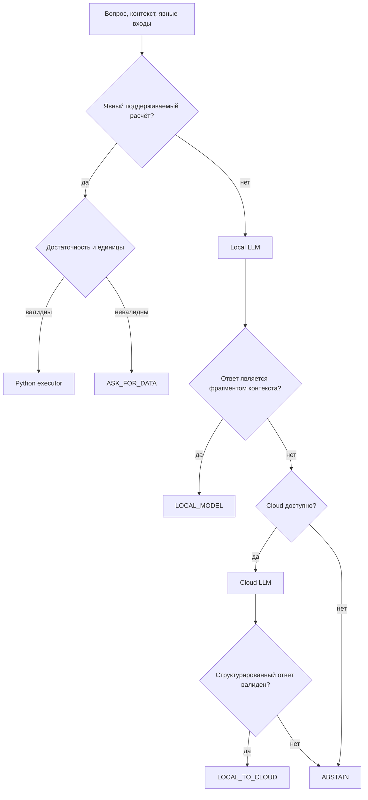

# Метод и реализованная архитектура

Python 3.12, stdlib HTTP server, httpx clients, llama.cpp CPU OpenAI-compatible endpoint, Inception cloud endpoint. NumPy/SciPy для анализа, Matplotlib для экспортируемых рисунков. Никаких внешних агентных orchestration framework, базы данных или farm integration не требуется.

Это диаграмма cascade. Direct baselines, rule и tool_cloud реализованы отдельными ветками того же `decide`. Никакие expected/category/split не передаются политике или модели. Hard gate использует только формулировку вопроса и явные inputs; не знает верного результата. Он требует глагола расчёта и однозначного поддерживаемого tool alias; negated/selection requests не исполняет. Произвольный natural-language extraction исходных чисел не реализован: UI принимает JSON или key=value, это сознательная граница минимального стенда.

## Численные исполнители

GDD: сумма max(0,(Tmin+Tmax)/2-Tbase), C·day, без верхнего ограничения. Base обязателен; Tmin≤Tmax. VPD: 0.6108 exp(17.27T/(T+237.3))·(1-RH/100), kPa; приближение по единственным T/RH, не суточная FAO оценка через extrema. ET0: суточная FAO-56 Penman–Monteith, mm/day; T C, Rn/G MJ/m²/day, u2 на высоте 2 m в m/s, es/ea/gamma kPa-related inputs, delta slope. Все нужны явно. Rain deficit: max(0,target−Σrain), mm; это разность со сценарной целью, не норма полива.

Основные формулы vapor pressure и ET0: [FAO-56 chapter 3](https://www.fao.org/4/x0490e/x0490e07.htm) и [chapter 4](https://www.fao.org/4/x0490e/x0490e08.htm). Проверки finite, RH range, единиц и достаточности входов предотвращают часть механических ошибок. Компактный валидатор не заменяет полный physical consistency check всех сочетаний величин. Negative rn и water balance в суточной формуле могут требовать отдельной предметной проверки; новые области применения сначала сверять с domain expert.

## Проверка локального ответа

`grounded` принимает только action ANSWER и непустую подстроку supplied context. Это ограниченная проверка происхождения; неверный по смыслу fragment тоже пройдёт. Не измеряет entailment, релевантность вопросу, confidence или калибровку. Поэтому формальные non-QA задачи без context почти всегда эскалируют. Результат abstention при offline честно отмечается, а не выдаётся за ответ. Уверенный текст локального LLM сам по себе не служит основанием принять ответ.

Cloud API errors/malformed JSON → ABSTAIN. Cloud timeout после local attempt также заканчивается отказом; текущая версия не делает второй невалидированный local fallback. Исключения сохраняются по type/status, без URL/auth headers. Данные модели отправляются только public request; worklogs не используются в prompt. Live server слушает только loopback, ограничивает payload и Origin, UI вставляет текст через textContent. Публикация сервера в интернет не выполнялась.

## Что расширять после первого этапа

Pre-generation selection может устранить local-stage latency на очевидно сложных вопросах. Для этого нужны labels качества и отдельная calibration split; не подходит оценка confidence, выдуманная моделью. Более сильный local extractor и semantic verifier должны демонстрировать вклад против tools+cloud. RAG retrieval качество нужно измерить отдельно от reader quality. Полная product orchestration сейчас не нужна.
