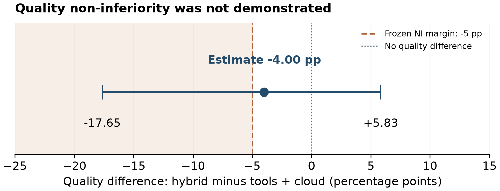

# What Does Local Inference Add After Deterministic Tools? A Reproducible Agricultural Routing Case Study

Antoniy Sarychev and Denis Shesternin  
Russian State Agrarian University – Moscow Timiryazev Agricultural Academy, Moscow, Russia  
WORKING DRAFT — NOT READY FOR SUBMISSION, 3 October 2026. Author consent, final affiliation spelling and human validation remain pending. Not submitted.

## Abstract

Local–cloud language-model cascades can reduce cloud use, but apparent gains may come primarily from deterministic tools. We examine this distinction in a reproducible agricultural question-answering case study on a 16-GB consumer GPU. A frozen controlled evaluation contains 150 cases, balanced between Russian and English, spanning six task categories and 25 documented source or scenario groups. Five policies produce 750 separately executed decisions. Tools plus cloud achieves 139/150 correct decisions; adding a local stage yields 133/150 while reducing cloud calls from 100 to 20. The paired quality difference is −4.00 percentage points, with a group-bootstrap 95% interval of [−17.65, +5.83]; the prespecified −5-point non-inferiority criterion is not met. Hybrid mean latency falls from 2.682 to 0.844 seconds. Compound answers expose a verifier failure: literal context support admits incorrect rule branches. We report token accounting, resource limits, offline behavior and procedural deviations. These results demonstrate an observed cloud-use and latency–quality tradeoff on controlled cases, not validated agronomic deployment. Human gold review and a more external source-disjoint evaluation remain necessary.

Keywords: language model routing; deterministic tools; agricultural QA; model cascades; selective prediction; edge inference.

## 1. Introduction

Agricultural decision support combines heterogeneous requests. Some ask for explanations grounded in an Extension document; others ask for growing degree days, vapor-pressure deficit, reference evapotranspiration, precipitation deficits or a supplied threshold rule. A fluent model response does not make a numerical calculation correct, and a request with insufficient measurements may require clarification instead of generation. This mixture creates a practical routing question: which component should answer each request, and what useful capability does a local model add after deterministic tasks are already resolved?

Prior research establishes cost-aware model cascades [1, 2], query-only quality-aware routing [3, 4] and a unified treatment of routing and cascading [5]. These studies make the present application an evaluation problem rather than a claim to invent model routing. Agricultural LLM and agent research already includes domain pretraining, retrieval, synthesized instruction data and tool orchestration [9–13]. Our narrower contribution is an operational ablation that separates deterministic tools from the local model, includes Russian and English cases, and measures actual request latency, token usage and resource sampling on one home PC.

The distinction matters because comparing a tool-assisted hybrid only against cloud-only can credit the local model for benefits delivered by tools. We therefore use tools plus cloud as the primary comparator. Our prespecified question is whether a local stage preserves quality within a five-point margin while reducing cloud calls, respecting a narrow operational error proxy and meeting a latency target. We report the failure of the quality criterion as a result. After inspection, the dataset is observed research material; any subsequent verifier or router changes require a genuinely new evaluation rather than relabeling a rerun as independent evidence.

## 2. Related work and the scope of novelty

FrugalGPT trains response-quality scores for cascades [1]. AutoMix conditions escalation on context-grounded self-verification and discusses the cost of verification [2]. Hybrid LLM predicts a small–large quality gap before generation [3], whereas RouteLLM learns preference-based routing and evaluates dataset augmentation and routing overhead [4]. The unified framework explicitly distinguishes initial routing from decisions using previous model outputs [5]. RouterBench evaluates cost–performance frontiers with cached multi-model outputs and predictive or nonpredictive routers [6]. Our measured historical policy is an output-conditioned cascade, not a trained equivalent of these query routers. We have not demonstrated superiority over published learned routers.

Reliability also depends on what a verifier establishes. Semantic Entropy Probes estimate uncertainty using learned probes on hidden states [7]; a structured field or self-reported confidence is not a substitute for that validation. The abstention literature separates query unanswerability, model knowledge limits and safety-oriented refusal [8]. ToolACE combines rule and model checks for synthetic function-calling data [15], while tau-bench evaluates completed goals and repeated interactions rather than syntax alone [14]. These distinctions motivate complete-request scoring and separate reporting of clarification, abstention and wrong answers.

PLLaMa adapts models to plant-science text [9]; AgriGPT combines agricultural data construction, fine-tuning and retrieval [10]; AgroLLM evaluates textbook-based agricultural retrieval [11]. AgriAgent already addresses contract-driven agricultural planning and capability-aware tools [12], and AgroTools evaluates multimodal agricultural tool use [13]. Thus neither “agriculture plus routing” nor use of a specific provider is sufficient methodological novelty. Our candidate contribution is a bounded, reproducible negative case study of the incremental local stage. Gemma's published architecture [17] and native ternary BitNet training [16] inform deployment choices, but neither technical report supplies performance evidence for our concrete runtime or quantization.

## 3. System and evaluation design

### 3.1 Policies and deterministic tools

All policies receive public task inputs; gold labels and scoring fields are excluded from provider requests. LOCAL uses the local model for every case. CLOUD uses the cloud model for every case. TOOLS+CLOUD first applies explicit deterministic eligibility and missing-input checks, then calls cloud where model inference remains necessary. TOOLS→LOCAL→CLOUD uses the same gate, attempts a local answer when context is supplied and accepts it when the original literal-support verifier passes; otherwise it escalates. With no acceptable local evidence it uses cloud. OFFLINE applies the gate and local stage with cloud unavailable and declines unresolved requests.

The gate preserves the four original deterministic implementations: GDD, VPD, FAO-style ET0 and rain deficit. It validates required inputs and units rather than letting the language model supply unreported measurements. Thirty numerical cases and twenty missing-input cases are handled by the tool/clarification gate in tool-assisted policies. Formal rule interpretation and supplied-threshold cases remain model-mediated categories; the historical gate is not a general rule executor. Such eligibility is determined from public inputs, not the expected answer. The original verifier checks literal support in supplied context; it does not prove that an answer follows the required multi-step computation.

### 3.2 Data, scoring and independence

The controlled evaluation contains 150 cases: agricultural QA 40, numerical calculation 30, insufficient data 20, tool selection 20, rule interpretation 20 and compound reasoning 20. Russian and English each contribute 75 rows. The QA portion draws on five documents; the remaining cases include controlled scenario families. There are 25 frozen `sample.group` clusters and 110 synthetic cases, or 73.3% of the dataset. Translation pairs and shared documents create dependence. This is not a representative sample of farm queries or a geographical generalization test.

The scoring rules were frozen before inference. They compare the required action, use strict answer-span exact matching with secondary token F1 for QA, apply math.isclose numerical tolerance (absolute difference at most max(0.02, 0.01 times the larger absolute prediction/reference)) with unit validation, and compare controlled labels/tool names exactly. Errors remain in the denominator. A narrow `critical_error` proxy marks an incorrect ANSWER on numerical or missing-data tasks; it does not cover every dangerous agronomic error, malformed output or wrong compound branch. Human adjudication of gold, translations and complete-answer adequacy is still pending. These software-defined scores must not be presented as human-validated correctness.

### 3.3 Hardware, models and settings

The measured PC has an AMD Ryzen 7 8700F, 8 cores/16 threads, 31.62 GiB RAM and an NVIDIA RTX 5060 Ti reporting 16,311 MiB VRAM. Windows 11 Pro build 26300 and NVIDIA driver 617.14 were recorded. Driver CUDA compatibility 13.4 does not establish an installed CUDA toolkit. LM Studio 0.4.25+1 serves authenticated local inference at a loopback endpoint. No credential values enter research artifacts.

The frozen local model is `gemma-4-26b-a4b-it`, quantization `IQ4_NL_XL`, context 4096, parallelism one, requested GPU offload ratio 0.70, temperature zero, top_p one, seed 42, reasoning none and maximum 512 completion tokens. The local output uses a strict five-field JSON schema: action, answer, numeric, unit and tool. The main GGUF contains 14,556,687,680 bytes. Actual GPU layer count is unknown; a requested ratio is not a measured allocation. The Gemma report describes total versus active MoE parameters [17], but our third-party quantization and runtime need their own empirical evaluation.

The cloud model is `mercury-2.5` through Inception, with instant reasoning, a 512-token limit and JSON-object output. Although temperature zero was requested, all 258 returned raw responses report replacement with temperature one. The twelve timed-out requests have no returned usage or temperature evidence. Therefore model behavior is not claimed to be deterministic. Local temperatures and seed likewise do not prove bitwise reproducibility across hardware.

### 3.4 Freeze, execution and estimands

The protocol was actually frozen at 2026-10-02 04:34:45.748327 UTC; the legacy filename containing 2026-10-01 is not a claim that it was frozen earlier. All 750 case–policy decisions were executed with a fixed shuffled/interleaved schedule. Responses were not reused between policies; no paid retries or final-data warmups were introduced. A Windows manifest-replacement error interrupted the first segment after six cases. A continuation ran only the remaining 144 under unchanged model, prompts, data, scoring and schedule. The first thirty decisions and twenty-two completed provider attempts were not rerun. Both segments and the interruption are retained in the provenance record.

The primary paired contrast is hybrid minus TOOLS+CLOUD quality. Success requires all four frozen conditions: the lower 95% quality-difference limit at least −5 percentage points; cloud-call reduction at least 10 points of all requests; upper limit for the narrow critical-error difference at most zero; and hybrid p95 latency at most ten seconds. The bounds are research choices, not agronomic standards. We use a 5,000-repeat paired cluster bootstrap over the 25 recorded groups with fixed seed 20261001 and report effect sizes. Dependence above these groups, including document/template families, can remain. A descriptive exact McNemar comparison does not resolve that dependence.

## 4. Results of the frozen controlled run

| Policy | Correct /150 | Accuracy | Cloud calls | Mean latency (s) | p50 (s) | p95 (s) |
|---|---:|---:|---:|---:|---:|---:|
| LOCAL | 102 | 68.00% | 0 | 1.508 | 1.422 | 2.349 |
| CLOUD | 130 | 86.67% | 150 | 4.758 | 1.446 | 38.115 |
| TOOLS+CLOUD | 139 | 92.67% | 100 | 2.682 | 1.277 | 3.340 |
| TOOLS→LOCAL→CLOUD | 133 | 88.67% | 20 | 0.844 | 1.094 | 1.561 |
| OFFLINE | 114 | 76.00% | 0 | 0.655 | 1.042 | 1.458 |

The hybrid quality difference is −4.00 points; its 95% group-bootstrap interval is [−17.65, +5.83]. The lower bound fails the frozen −5-point criterion. The interval includes zero, so failure to establish non-inferiority is not proof of statistically significant inferiority. Hybrid wins on seven paired cases and loses on thirteen; descriptive McNemar p=0.2632 is not evidence of equivalence. The other criteria pass on this sample: 53.33-point absolute cloud-call reduction, zero observed change in the narrowly defined critical proxy, and p95 1.561 seconds. A zero-error difference and a degenerate bootstrap interval from a narrow task definition do not establish farm safety.

Figure 1. Hybrid minus TOOLS+CLOUD quality: −4.00 pp, cluster-bootstrap 95% CI [−17.65, +5.83]; the lower bound crosses the prespecified −5 pp margin. There are 150 paired cases and 25 frozen groups, with 5,000 resamples. The interval includes zero; this is failure to demonstrate non-inferiority, not proof of significant inferiority.

### 4.1 Category behavior and false acceptance

| Category (n) | LOCAL | CLOUD | TOOLS+CLOUD | Hybrid | OFFLINE |
|---|---:|---:|---:|---:|---:|
| Agricultural QA (40) | 36 | 37 | 32 | 36 | 36 |
| Numerical (30) | 0 | 23 | 30 | 30 | 30 |
| Insufficient data (20) | 18 | 18 | 20 | 20 | 20 |
| Tool selection (20) | 20 | 18 | 20 | 19 | 0 |
| Rule interpretation (20) | 20 | 18 | 19 | 20 | 20 |
| Compound reasoning (20) | 8 | 16 | 18 | 8 | 8 |

Tools account for the exact-scored numerical and clarification successes; LOCAL's zero numerical score does not by itself diagnose an absence of arithmetic capability. The primary local-stage weakness is compound reasoning: hybrid accepts twelve incorrect answers. Labels such as ALERT and OK both occur in supplied context, so the literal-support check admits a wrong branch. This is a post-hoc mechanism diagnosis, not a new independent experiment. Fixing that verifier after observing these cases cannot improve the frozen historical claim.

Overall hybrid accuracy is 68/75 in Russian and 65/75 in English. QA is 19/20 Russian and 17/20 English for hybrid. The observed subset therefore does not show a Russian disadvantage, but source/translation dependence, small category samples and exact-span scoring limit language claims. It does not establish acceptable Russian performance for open-ended agronomic advice.

OFFLINE scores 114/150 and answers 110/150, clarifies 20/150 and abstains on 20/150. Those abstentions occur on tool-selection tasks whose gold expects an answer. There are no gold ABSTAIN cases in the frozen set; a correct-abstention rate is therefore unavailable. Offline resilience should be evaluated as task coverage and refusal adequacy, not parity with cloud.

### 4.2 Reliability, speed, usage and resources

Across policies, 310 local and 270 cloud attempts are logged. Local attempts have no recorded transport/parse error. Cloud attempts contain 21 errors: twelve read timeouts, six JSON decoding errors, two ValueErrors and one incomplete completion. CLOUD has sixteen erroneous decisions, TOOLS+CLOUD five and hybrid none among its twenty cloud requests. Different call counts and interleaved service conditions preclude treating this as a guarantee that the hybrid's cloud provider is intrinsically more reliable.

Hybrid mean latency is 1.838 seconds lower than TOOLS+CLOUD, a 68.55% reduction; p95 is 1.779 seconds lower, a 53.27% reduction. The paired group-bootstrap mean-latency difference interval is [−3.660, −0.079] seconds. Request timers include routing, tools and HTTP work but exclude two cold loads of 14.778 and 8.767 seconds and the 998.585-second gap between resource-sampling segments. These values describe the observed policies and workload, not isolated model decoding benchmarks.

Client-side local median TTFT is 0.578 seconds for LOCAL and approximately 0.280 for hybrid/offline local calls. Estimated completion throughput is 46.65, 47.96 and 48.00 tokens/s, respectively. These estimates divide reported completion tokens by first-to-last nonempty streamed-delta time; they are not backend decode TPS. Cloud TTFT and backend TPS are unknown because the frozen cloud call is not streamed. Sampled peak total GPU use is 13,758 MiB, and peak total system RAM is 24.754 GiB across 2,862 samples. These are whole-device/system quantities with other applications present, not per-model private allocations or instantaneous peaks.

| Calls included | Calls | Known input tokens | Known completion tokens | Usage coverage |
|---|---:|---:|---:|---:|
| LOCAL local | 150 | 76,582 | 5,749 | 150/150 |
| CLOUD cloud | 150 | 86,561 | 25,027 | 142/150 |
| TOOLS+CLOUD cloud | 100 | 55,437 | 14,134 | 96/100 |
| Hybrid local | 80 | 39,476 | 2,649 | 80/80 |
| Hybrid cloud | 20 | 10,781 | 2,401 | 20/20 |
| OFFLINE local | 80 | 39,476 | 2,649 | 80/80 |

The frozen token-price assumptions, checked on 1 and 2 October 2026, are $0.04/M input and $0.15/M completion tokens. They are provider pricing metadata, not scientific references or an invoice. Hybrid's cloud estimate is $0.00079139 for 150 tasks; TOOLS+CLOUD's known uncached-token component is $0.00433758 plus four unknown-usage requests. CLOUD's known component is $0.00721649 plus eight unknown requests. Unknown usage is not zero. Reported cloud reasoning tokens, 2,350, are a subset of completion tokens and are not added again. Local electricity, depreciation, private memory allocation and full operating cost are unmeasured. Consequently we do not report an exact total-cost saving or infer billing from consumer subscriptions.

## 5. Subsequent development and external-data audit

**Supplementary pre-inference gateway comparison: observed DEV, not a new confirmatory result.** A subsequent run executed 36 previously available development cases under six policies, producing 216 recorded decisions with no missing cases. Each category contributes six cases; the sample has 21 English/15 Russian rows and 21 groups. Its QA category is English-only; overall language comparisons are confounded by task mix. This run leaves the frozen150 result above unchanged.

The six arms share Gemma/Mercury generators: TOOLS+CLOUD, the previous cascade, rule-first, hosted Jev-first, local CPU Laya-first and offline Laya. The three pre-routing arms share an additional lexical ambiguity guard; comparison with the previous cascade therefore also changes that guard. The primary Jev-versus-rule contrast shares guards. Laya uses a resident CPU float32 worker with four threads, 1,024 input/head-256 limits, explicit truncation records and separate load/warmup accounting. Hosted routing calls and generative cloud calls are distinct: Jev routing followed by local generation remains external processing.

| DEV policy | Correct /36 | Gen. cloud | Hosted router | Total external | Mean (s) | p95 (s) | Known USD + unknown events |
|---|---:|---:|---:|---:|---:|---:|---:|
| TOOLS+CLOUD | 31 | 24 | 0 | 24 | 4.314 | 17.156 | 0.00118831 + 2 |
| Previous cascade | 32 | 18 | 0 | 18 | 4.349 | 17.232 | 0.00081088 + 2 |
| Rule-first | 31 | 23 | 0 | 23 | 6.244 | 60.543 | 0.00098890 + 3 |
| Jev-first | 30 | 20 | 36 | 56 | 1.614 | 2.953 | 0.002297568 + 0 |
| Laya-first | 23 | 13 | 0 | 13 | 2.981 | 2.823 | 0.00045803 + 1 |
| Offline Laya | 12 | 0 | 0 | 0 | 0.793 | 1.016 | 0 + 0 |

Jev-first does not improve observed quality over rule-first: 30/36 versus 31/36, paired difference −2.78 pp with group-bootstrap 95% CI [−20.69, +12.12]. It saves three generative cloud calls but raises total external requests from 23 to 56. Its complete returned-usage remote estimate is larger than the known rule component; three unknown rule charge events prevent an exact total-billing comparison. Eight cloud timeouts occurred across the run and differ by arm. The lower Jev mean/p95 therefore does not isolate a causal router-speed improvement; provider failures and their timeout tails contribute materially. Laya-first loses eight correct decisions versus rule-first (−22.22 pp; exploratory 95% CI [−43.24, −2.56]); offline Laya scores 12/36 with zero remote requests. Neither result establishes a suitable standalone agricultural router or calibrated confidence.

The supplementary raw-journal SHA-256 is `4b690c7bc40373d10fbfdbc8f30cf3b306cf5b0373b0df516448f6cf99681e95`; its protocol SHA is `00e81a8893b40b745a56ee39f15de58118cb009c43b9d61bfb333024139dcb83`. A preceding failed-start directory contains no policy decisions; it is retained as a disclosed startup artifact, and answers were not replayed from it. Source analysis is the archived supplementary analysis. Human review remains false. These data support development diagnostics and caution about external-call accounting, not a replacement independent holdout.

Our external-data audit finds that the publicly provided Kaggle package contains forty English simple-instruction cases for a small TinyStories-adapted model, rather than agricultural or Russian QA. Its training artifacts are absent; train/eval contamination cannot be reconstructed. It may support separate development diagnostics, but not a new agricultural confirmatory test.

A more suitable AgXQA dataset [18] nevertheless needs source grouping. Its current 1,503/353/330 train/validation/test rows share 44 source references and 170 exact contexts between train and test; 78 test questions match the project's previously stored 570 questions. After removing train/validation sources and old known questions/contexts, only one test row remains under this conservative filter. Thus an official split label alone does not establish our independence. Pretraining contamination of the evaluated models remains unknown.

A forty-row review pack was prepared from licensed ERA5 weather data: twenty authored Russian/English scenario pairs, including calculations, missing inputs, simplified rules, compound tasks, provenance checks and abstention. It is exploratory, has one shared reanalysis block, and has not been used for inference or tuning. Provisional machine-created gold is kept separately from blinded reviewer inputs. Human review is false. Reanalysis is not farm sensor ground truth, and API ET0 is not measured crop water use. This pack supports a concrete human audit workflow; it is not a completed independent holdout.

### 5.1 Versioned diagnostic audit and supplementary free-model screen

An independent Decimal recheck on 3 October agrees with the 30 numerical gold values. All 30 LOCAL numerical responses contain valid structured ANSWER outputs and the required units, but their values are outside the frozen tolerance. No unit, action/schema, formatting, parsing, incomplete-response or evaluator artifact explains this category's zero score. No intermediate derivation was recorded, so wrong arithmetic operations and wrong formula selection cannot be separated per response. This is a versioned diagnostic, not a rescore of HOME150.

The independent compound check agrees with gold on all 100 case-policy decisions. The historical verifier actually accepted 12 incorrect hybrid answers and 12 incorrect offline answers. Fixed LOCAL has another 12 incorrect labels that would pass literal grounding; that arm did not invoke the verifier, so these are not additional observed verifier acceptances. A separate DEV-only v2 candidate implements typed conjunction, negation, entity, branch, component and unit checks. It is not connected to historical or production policies. It returns UNKNOWN on untyped natural-language QA; it does not claim general agronomic entailment. Its public fact inventory and rule must come from task evidence independently of hidden gold. ASK/ABSTAIN explanations still require approved reference answers or human semantic review. Historical policy/scorer bytes remain unchanged. Actual human adjudication is still absent.

A new supplementary OpenRouter screen used the same nine observed DEV inputs across three explicit free models, with single-provider pins, no retries, all-zero price checks before every request and an existing zero-paid-limit inference key. Qwen3.8 27B scores 5/9, Ling 3.0 Flash Sante 4/9 and Dots3-Note Preview 4/9 under the historical strict scorer. Median end-to-end latencies are 0.673, 1.163 and 1.763 seconds; input/output tokens are 4,205/272, 4,343/358 and 4,077/309. All 27 responses are HTTP200, valid exact JSON schema and API-reported cost zero; key usage remains zero. These are paired development observations, not a new independent holdout or a robust model ranking. Dots is a preview alias. Mercury remains the historical cloud comparator.

The requested 21-name catalogue was resolved, but only seven distinct models received attempts across three separate new runs: four returned generations, three had distinct HTTP failures. Nine text candidates were absent from the account-filtered catalogue, two eligible candidates were not run under the bounded plan, and two paid music models plus one safety classifier were skipped. The management key explains the old 401; a new Ling3.1 response identifies the zero-total-limit 403, Apodex rejects json_schema despite advertised metadata, and Gemma26 reports an upstream shared-pool 429. The previous LFM privacy/ZDR incompatibility remains a blocker; exact account toggles are not API-observable here. Failed-attempt usage is unknown individually. Shared DEV costs are confirmed zero; no invoice or total-cost saving is inferred.

Two blank blinded reviewer forms were prepared for Antoniy and Denis. The current review40 contains no generated model answers, so this phase independently checks questions/references and authors gold; it cannot measure model-answer accuracy. Expert-needed or disputed cases remain unresolved until real adjudication. The next source-disjoint study is DATA_BLOCKED, with no new protocol freeze or confirmatory inference. New external-source candidates have separate source-group and rights audits; row count and translations do not establish independence.

## 6. Limitations and reproducibility

The study uses one home PC, one selected local quantization, one cloud model, a controlled mix dominated by synthetic cases and five QA documents. Category exact scoring may reject semantically equivalent answers or reward insufficiently complete text; both are reasons for a blinded human audit rather than silent score repair. The primary bootstrap handles documented groups but may miss higher-level source/template dependence. The provider clamps the requested temperature, timeouts have unknown usage, and two execution segments introduce a disclosed temporal gap. Model choice and prompts were developed before this run, but the now-observed cases cannot be used again as independent confirmation after tuning.

We retain frozen dataset/protocol bytes, raw provider traces, resource samples, segment manifests, normalized scores and paired analysis. The raw-journal SHA-256 is `70cdc82fe4d9f01a09b10287304c6a7f7f25f61d13c3fbdab91c1cf7c0a6e922`; the dataset hash is `3a4d47451fec18794b084d08d5f45c80b1443d3f99afca4656f9b335b578ac03`. A separate reporting correction repairs five ASK coverage fields after an action-name mismatch; it does not alter accuracy, scoring, frozen criteria or raw output. Pre-final software validation passed 213 tests and post-work validation 241; these checks establish software behavior rather than expert agronomic validity. Model weights, credentials and full third-party paper texts are excluded from the research release.

The next confirmatory study should use human-adjudicated, source-disjoint external cases; keep translation pairs in the same group; freeze query routing, compound completeness and scoring before inference; and include true gold-abstention examples. Representative query-router and cascade baselines, repeated trials and broader document/weather blocks would strengthen generalization. These are remaining experiments, not claims about completed work.

## 7. Conclusion

In this controlled study, deterministic tools plus cloud outperform both cloud-only and the tested local cascade in exact-scored quality. Adding local inference reduces cloud calls by 80% relative to the tool baseline and lowers observed latency, but fails to establish the prespecified quality non-inferiority condition. The compound false-acceptance mechanism illustrates why literal support and valid structure cannot replace complete-task correctness. The result supports a reproducible tradeoff analysis and a concrete next experiment; it does not establish validated field decision support or a new routing algorithm.

## AI assistance, author review and availability

AI assistance was used substantially for experiment/audit code, source organization, analysis support and English drafting. Human authors remain responsible for factual claims, references, data rights, gold/scorer validity and final submission. Author approval and the blinded human review are pending; no AI system is listed as an author. No arXiv submission, endorser contact or manuscript-license choice has been made.

Artifacts are retained in the research repository; a release suitable for public scientific reuse requires the stated author and data-rights review. Core literature acquisition metadata and selected-section reading records are in the archived supplementary analysis. No claim of fully reading every cited PDF is made.

## References

1. Chen, L., Zaharia, M., and Zou, J. *FrugalGPT: How to Use Large Language Models While Reducing Cost and Improving Performance*. arXiv:2305.05176, 2023. https://arxiv.org/abs/2305.05176
2. Aggarwal, P., et al. *AutoMix: Automatically Mixing Language Models*. arXiv:2310.12963, 2023; version 5, 2025. https://arxiv.org/abs/2310.12963
3. Ding, D., et al. *Hybrid LLM: Cost-Efficient and Quality-Aware Query Routing*. arXiv:2404.14618, 2024. https://arxiv.org/abs/2404.14618
4. Ong, I., et al. *RouteLLM: Learning to Route LLMs with Preference Data*. ICLR 2025; arXiv:2406.18665. https://arxiv.org/abs/2406.18665
5. Dekoninck, J., Baader, M., and Vechev, M. *A Unified Approach to Routing and Cascading for LLMs*. ICML 2025, PMLR 267:12987–13010; arXiv:2410.10347. https://proceedings.mlr.press/v267/dekoninck25a.html
6. Hu, Q. J., et al. *RouterBench: A Benchmark for Multi-LLM Routing System*. arXiv:2403.12031, 2024. https://arxiv.org/abs/2403.12031
7. Kossen, J., et al. *Semantic Entropy Probes: Robust and Cheap Hallucination Detection in LLMs*. arXiv:2406.15927, 2024. https://arxiv.org/abs/2406.15927
8. Wen, B., et al. *Know Your Limits: A Survey of Abstention in Large Language Models*. arXiv:2407.18418, 2024, updated 2025. https://arxiv.org/abs/2407.18418
9. Yang, X., et al. *PLLaMa: An Open-source Large Language Model for Plant Science*. arXiv:2401.01600, 2024. https://arxiv.org/abs/2401.01600
10. Yang, B., et al. *AgriGPT: a Large Language Model Ecosystem for Agriculture*. arXiv:2508.08632, 2025. https://arxiv.org/abs/2508.08632
11. Samuel, D. J., et al. *AgroLLM: Connecting Farmers and Agricultural Practices through Large Language Models for Enhanced Knowledge Transfer and Practical Application*. arXiv:2503.04788, 2025. https://arxiv.org/abs/2503.04788
12. Yang, B., et al. *AgriAgent: Contract-Driven Planning and Capability-Aware Tool Orchestration in Real-World Agriculture*. arXiv:2601.08308, 2026. https://arxiv.org/abs/2601.08308
13. Ye, Z., et al. *AgroTools: A Benchmark for Tool-Augmented Multimodal Agents in Agriculture*. arXiv:2605.22366, 2026. https://arxiv.org/abs/2605.22366
14. Yao, S., et al. *tau-bench: A Benchmark for Tool-Agent-User Interaction in Real-World Domains*. arXiv:2406.12045, 2024. https://arxiv.org/abs/2406.12045
15. Liu, W., et al. *ToolACE: Winning the Points of LLM Function Calling*. ICLR 2025; arXiv:2409.00920. https://arxiv.org/abs/2409.00920
16. Ma, S., et al. *The Era of 1-bit LLMs: All Large Language Models are in 1.58 Bits*. arXiv:2402.17764, 2024. https://arxiv.org/abs/2402.17764
17. Gemma Team, et al. *Gemma 4 Technical Report*. arXiv:2607.02770, 2026. https://arxiv.org/abs/2607.02770
18. Kpodo, J., Kordjamshidi, P., and Nejadhashemi, A. P. *AgXQA: A benchmark for advanced Agricultural Extension question answering*. Computers and Electronics in Agriculture 225:109349, 2024. https://doi.org/10.1016/j.compag.2024.109349

References 1–17: primary metadata and relevant PDF sections checked. Reference 18: primary bibliographic metadata/dataset card checked; complete publisher article not read here. Software documentation, provider prices and official publication rules are documented separately and do not inflate this scientific-reference count.
